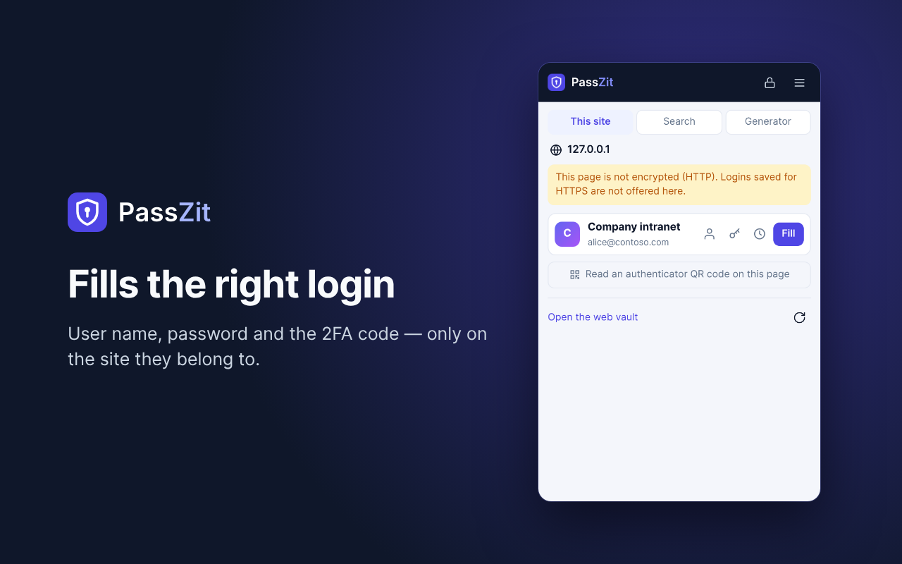
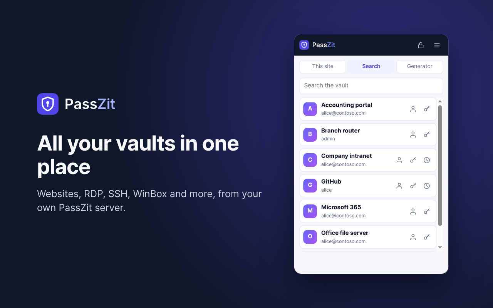

<p align="center">
  <picture>
    <source media="(prefers-color-scheme: dark)" srcset="brand/passzit-logo-on-dark.svg">
    
  </picture>
</p>

# PassZit

[](https://github.com/Max-Zit/passzit/releases/latest)
[](LICENSE)
[](https://github.com/Max-Zit/passzit/actions/workflows/ci.yml)
[](https://github.com/Max-Zit/passzit/actions/workflows/security.yml)

**Free, open-source, self-hosted password manager** for people and teams — your own server, end-to-end encrypted vaults, and browser extensions for Chrome, Edge, Firefox, Opera, Brave and Vivaldi.

> **Status:** under active development; the first public release was 0.9.0 in November 2026 and new versions come out often. Development happens on the `develop` branch; follow the repository or [Discussions](https://github.com/Max-Zit/passzit/discussions) for news.

**Browser extension:** [Chrome Web Store](https://chromewebstore.google.com/detail/kldmhdpnijihjfgfgngfjooppfhidcfc) (also Brave, Opera, Vivaldi) · [Firefox Add-ons](https://addons.mozilla.org/firefox/addon/passzit/) · [Microsoft Edge Add-ons](https://microsoftedge.microsoft.com/addons/detail/lnncodjlllmeaoebmnncjaofiaiipghe) (update to 0.9.4 in review) · or download it from your PassZit console (*Extensions*).

| | |
|---|---|
| [](packaging/stores/images/store-1.png) | [](packaging/stores/images/store-2.png) |
| Fills the login and 2FA code only on the site it belongs to | Websites, remote connections and more from your own server |

## Installation

| Way | Best for |
|---|---|
| **VM image** (OVA for VMware/VirtualBox, QCOW2 for Proxmox/KVM, VHDX for Hyper-V) | import, start, sign in — Debian, PostgreSQL and PassZit ready |
| **Appliance ISO** | a new VM or a physical server |
| **Install script** | an existing Debian 12+, Ubuntu 22.04+, AlmaLinux / Rocky Linux 9+ server |
| **Packages** (deb, rpm; amd64, arm64) | your own PostgreSQL and configuration |

```sh
curl -fsSL https://github.com/Max-Zit/passzit/releases/latest/download/install.sh | sudo sh
```

The script checks the release signature, installs PostgreSQL, starts the service and prints the address and the setup token. Open `https://SERVER:8443`, enter the token and create the first administrator. Images and packages: [latest release](https://github.com/Max-Zit/passzit/releases/latest). Requirements: 2 vCPU, 2 GB RAM, 16 GB disk.

## Features

- **End-to-end encryption, zero knowledge:** the browser derives keys from the master password with Argon2id (64 MiB, 3 passes), encrypts every item — name, user name, password, websites, notes, files — with AES-256-GCM and sends only ciphertext. The server stores an argon2id hash of a separate auth key and never sees the master password or any key it could use. Details: [docs/ARCHITECTURE.md](docs/ARCHITECTURE.md).
- **Web vault:** websites, remote connections (RDP, SSH, WinSCP, WinBox, VNC, Telnet), SSH keys (Ed25519 generated in the browser), secure notes, cards, identities; one-time codes (TOTP, also read from a QR code), encrypted file attachments, own fields, nested folders typed as customer, site, branch, department, data center, network or project, favourites, search across all vaults, trash, password history with restore, documentation per item (an encrypted page with headings, tables, code and pictures), password health report with an optional breach check (k-anonymity), clipboard clearing; installable as an app.
- **Passkeys in the vault:** the extension saves website passkeys as encrypted vault items and signs in with them in every browser it runs in.
- **Unlock:** one unlock for the web vault and the browser extension; no automatic lock by default (the policy or the user can set one); unlock with **Windows Hello**, Touch ID or the phone's screen lock through a passkey (WebAuthn PRF — the server keeps only the sealed key).
- **Browser extensions** for Chrome, Edge, Opera, Brave, Vivaldi and Firefox, from the stores or the console; connected by entering the server address: fill logins and one-time codes only on the matching site (Public Suffix List), offer to save new and changed logins, scan a 2FA QR code, generator, search.
- **Remote connections:** double-click an RDP, SSH, WinSCP, WinBox, VNC or Telnet item and the paired **MaxZit Launcher** (shared with [WatchZit](https://github.com/Max-Zit/watchzit), downloadable from the console) opens it with the stored credentials — also in one click from a device in WatchZit (*Open with*).
- **Teams:** shared vaults with per-user rights (view, use, edit, manage), groups, time-limited access, access requests with approval (more rights for some hours), LDAP and SSO (OIDC, SAML) sign-in, secret links, emergency access, per-item access log, four-eyes approval.
- **Command line:** the `passzit` command (Linux, Windows, macOS) reads logins and one-time codes in scripts, and `passzit rotate` changes device passwords over SSH (Linux, MikroTik, Windows) and saves the new ones; it decrypts on its own computer.
- **Import and export:** Chrome, Edge, Firefox, Safari, Bitwarden, KeePass/KeePassXC, 1Password, LastPass and generic CSV; encrypted PassZit export.
- **Accounts:** only by invitation; mandatory two-factor sign-in (TOTP, security keys and passkeys, recovery codes); recovery key for a forgotten master password; master-password change without re-encrypting the items.
- **Administration:** roles, vault policy (lock time, clipboard, key derivation, minimum length, trash, file limits, breach check), sessions and sign-in blocks, IP allow-list, hash-chained audit log, e-mail notifications; interface in 14 languages; user guide in English and Serbian.
- **Operation:** one-line installer with signature check, deb/rpm packages, appliance images, certificates from Let's Encrypt (HTTP-01 or Cloudflare DNS-01) or uploaded, signed self-update with rollback and Stable/Testing channels, encrypted daily console backups with SFTP copy and restore.

## Planned

- Safari and mobile apps.
- More import formats.

## Building

```sh
go run ./tools/buildwasm                          # Argon2id WebAssembly module for the browser
go build -o passzit-server ./cmd/passzit-server
./passzit-server --dev-embedded-db --data-dir ./data --listen 127.0.0.1:8443
```

Open `https://127.0.0.1:8443`, enter the setup token from `./data/setup-token.txt` and create the first administrator. Tests: `go test ./...` (the browser-crypto test runs when Chrome or Edge is installed).

PassZit is made by [MaxZit](https://maxzit.com), like [BackupZit](https://github.com/Max-Zit/backupzit), [RMMZit](https://github.com/Max-Zit/rmmzit) and [WatchZit](https://github.com/Max-Zit/watchzit).

## License

GNU Affero General Public License v3.0 — see [LICENSE](LICENSE). Third-party components: [THIRD_PARTY_LICENSES.md](THIRD_PARTY_LICENSES.md). Paid support will be offered by MaxZit.
